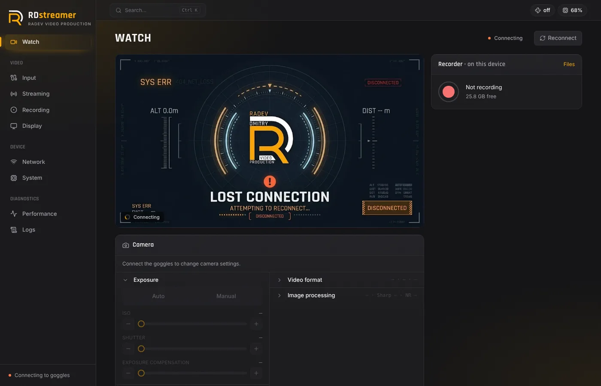
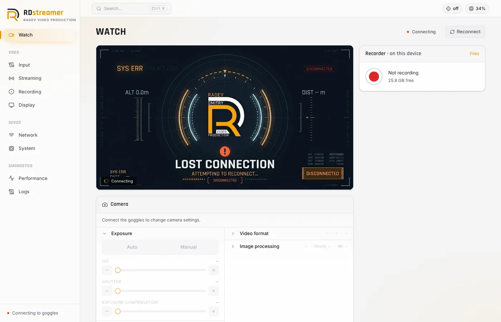
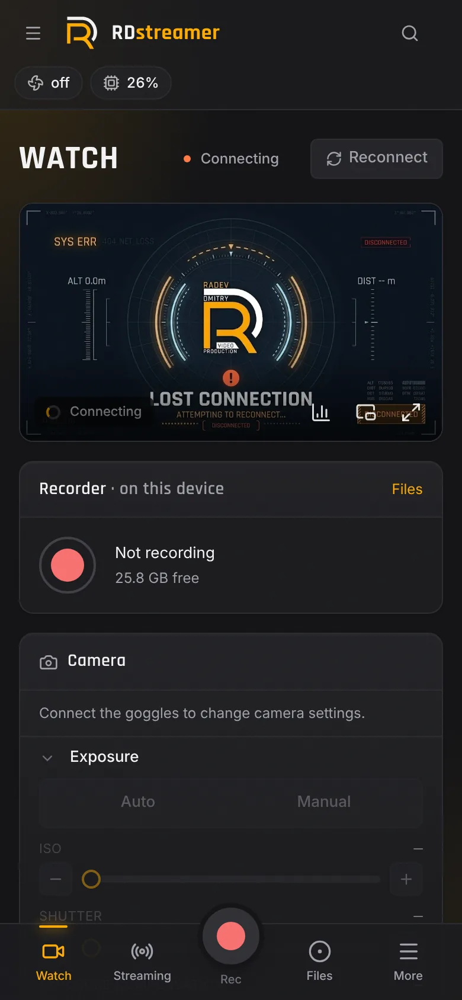

<div align="center">

<picture>
  <source media="(prefers-color-scheme: dark)" srcset="docs/rdstreamer/logo-dark.svg" />
  
</picture>

# RDstreamer

**Your FPV feed, on every screen. Made for the Argon ONE case, with working fan control.**

A fork of [**YStreamer**](https://github.com/YLabs-FPV/YStreamer) by YarosFPV:
Raspberry Pi 4 software that takes the live video from your DJI goggles or a USB
camera and sends it to an HDMI screen, any browser, RTSP/SRT/RTMP/UDP streams
and recordings, all at once. RDstreamer adds built-in Argon ONE case support, a
new look and a faster web interface.

[](LICENSE)
[](https://www.raspberrypi.com/products/raspberry-pi-4-model-b/)
[](https://www.rust-lang.org)
[](https://github.com/YLabs-FPV/YStreamer)

[**⬇️ Download**](https://github.com/radievdmytro/RDstreamer/releases) &nbsp;·&nbsp;
[**🆕 What's new**](#whats-new-in-rdstreamer) &nbsp;·&nbsp;
[**📖 YStreamer docs**](https://ystreamer.yarosfpv.com/docs)


</div>

> [!IMPORTANT]
> **Made for the Raspberry Pi 4 in an Argon ONE (V2) case.** The case's fan
> control works out of the box: RDstreamer runs the fan on its own temperature
> curve, set from the web interface, and handles the case's power button and
> power cut too. No Argon40 scripts or `argononed` needed.
> [More below](#-argon-one-case-built-in).

---

## What's new in RDstreamer

Everything YStreamer does, RDstreamer does too. On top of it:

### 🌀 Argon ONE case, built in

No Argon40 scripts, no `argononed`, nothing to install: the case works from the
first boot of the image.

- **Fan control with a curve you set in the browser** (System → General →
  Cooling fan). Comes with a quiet curve: off until 45 °C, then 5 %, 25 %, 55 %
  and 100 % at 65 °C. The fan speeds up at once and slows down only after 30 s,
  so it doesn't hunt around a threshold. A curve that doesn't reach 100 % by
  75 °C can't be saved, so the Pi can't be left to overheat.
- **The case's power button**: double tap reboots, a 3 s hold powers off.
  Recordings are finished first.
- **Power cut after shutdown**: the case switches itself off once the Pi is down.
- **Spin-up kick** (optional) for fans that don't start slowly from standstill.
- **Auto / On / Off**: Auto runs the case when its controller answers on I2C and
  no HAT is fitted, so RDstreamer never touches other hardware.
- **Moving from argononed** takes one click: it's switched off and its fan curve
  comes along.
- **Fan speed on the Performance page**, next to the temperature.
- I2C is switched on by the package itself.


### 🎨 A new look

- **Dark grey with the orange of the RD logo**, dark by default. The light theme
  and "follow the system" are still there.
- **The RD logo** in the sidebar, on the login screen and on the HDMI splash.
- **Squared, technical headings** (Rajdhani), frosted panels, a warm glow and
  fine grain in the background.
- **Things that are live look live**: a glowing current page, breathing status
  dots, a pulsing record button, viewfinder corners and an orange halo around
  the live picture.
- **A picture in the player while there's no video**, instead of a black box.
  Swap `device/frontend/public/no-signal.webp` for your own.

<table>
  <tr>
    <td width="50%"><br /><sub><b>Watch page, dark</b></sub></td>
    <td width="50%"><br /><sub><b>Light theme</b></sub></td>
  </tr>
</table>

### ⚡ Faster to use

- **Status bar on every page**: processor temperature, fan, processor load,
  incoming bitrate and the recording timer. Each one links to its page.
- **Command palette**: press <kbd>Ctrl</kbd>+<kbd>K</kbd> (<kbd>⌘</kbd>+<kbd>K</kbd>
  on a Mac) or <kbd>/</kbd> to jump to any page or tab, start or stop recording,
  or switch the theme.
- **Phone bottom bar**: Watch, Streaming, a big record button with the timer,
  Files and More, all under your thumb.

<table>
  <tr>
    <td width="62%"><br /><sub><b>Command palette</b></sub></td>
    <td width="38%"><br /><sub><b>On a phone</b></sub></td>
  </tr>
</table>

### 📡 Its own names

| | YStreamer | RDstreamer |
| --- | --- | --- |
| Wi-Fi access point | `YStreamer` / `ystreamer` | `RDstreamer` / `RDstreamer` |
| Address | `ystreamer.local` | `rdstreamer.local` (or `10.0.0.1` on its own Wi-Fi) |
| SSH login | `ystreamer` / `ystreamer` | `rdstreamer` / `rdstreamer` |
| NDI / OMT source name | `YStreamer` | `RDstreamer` |

### 🛠️ Built on GitHub

**Actions → Build RDstreamer → Run workflow** builds the package and the SD card
image from any branch and publishes both as a release.

---

## Getting started

1. [Download `rdstreamer-….img.xz`](https://github.com/radievdmytro/RDstreamer/releases)
   from the latest release.
2. Flash it with Raspberry Pi Imager (**Use custom**) or balenaEtcher.
3. Boot the Pi, join the `RDstreamer` Wi-Fi network (password `RDstreamer`) and
   open `http://10.0.0.1` or `http://rdstreamer.local`. An HDMI screen shows the
   details and a QR code too.
4. Set a password for the web interface under **System → General → Access**.

> [!IMPORTANT]
> RDstreamer packages aren't signed with YStreamer's key. Don't install
> YStreamer updates from **System → Updates**: that would bring back plain
> YStreamer. Update by flashing a new RDstreamer image, or with
> `sudo apt install ./ystreamer_*.deb` from a release.

---

## Everything else: as in YStreamer

The rest works exactly as in [**YStreamer**](https://github.com/YLabs-FPV/YStreamer),
and its [documentation](https://ystreamer.yarosfpv.com/docs) applies (with the
names above in place of YStreamer's).

### What it does

Plug your goggles into a Raspberry Pi 4 and everyone else gets to see what you
see. One USB-C cable in, and every output at the same time:

- **HDMI** - the feed on a TV, monitor or projector, with your logo on top.
- **Any browser** - live view on phones and laptops, over WebRTC or WebSocket.
- **Streams** - an RTSP server, plus SRT, RTMP (YouTube, Twitch, Facebook) and
  UDP for OBS, VLC, QGroundControl and Mission Planner.
- **Mixers** - NDI and OMT sources that vMix, OBS and TriCaster find on the
  local network by themselves.
- **Recording** - MP4 or MPEG-TS to the SD card or a USB drive, started by hand,
  automatically when video arrives, or with a physical button.

It also changes the **air unit's camera settings** from the browser, shows the
**goggles' battery and link quality**, passes the goggles' link through to
**DJI Fly** on an Android phone, and offers **remote access** through
Tailscale or WireGuard.

### Supported inputs

| Source                                        | Port  | Video | Camera settings | Battery & link |
| --------------------------------------------- | :---: | :---: | :-------------: | :------------: |
| DJI Goggles 2, Integra, Goggles 3, Goggles N3 | USB-C |  ✅   |       ✅        |       ✅       |
| DJI RC-N2 / RC-N3 remote _(experimental)_     | USB-C |  ✅   |       ❔        |       ❔       |
| DJI FPV Goggles V1 / V2 _(experimental)_      | USB-A |  ✅   |       ❌        |       ❌       |
| USB cameras, capture sticks, analog receivers | USB-A |  ✅   |        -        |       -        |
| RTMP stream from OBS, a phone app or DJI Fly  |  LAN  |  ✅   |        -        |       -        |

_Which camera settings can be changed depends on the air unit (O3, O4, O4 Pro)._

> [!NOTE]
> RDstreamer and YStreamer are independent projects. They are not affiliated
> with, endorsed by or sponsored by DJI or Argon40.

### What you need

- **Raspberry Pi 4 Model B**, ideally in an **Argon ONE (V2)** case.
- **A microSD card**, 16 GB or more.
- **Power that leaves the Pi's USB-C port free**: the Argon ONE case's own
  USB-C power input, the GPIO header or a PoE HAT. The Pi's USB-C port is
  reserved for the goggles.
- **A USB-C to USB-C data cable** for the goggles, or a USB camera.

Wi-Fi runs on 2.4 GHz only, on purpose: 5 GHz is where the goggles' video link
lives. See [What you need](https://ystreamer.yarosfpv.com/docs/getting-started/requirements).

### Building from source

Tasks run through [mise](https://mise.jdx.dev), which also installs the
toolchains (Rust, Node, pnpm):

```sh
# The web interface against a device on your network, with hot reload
cd device/frontend && pnpm install && PI_HOST=192.168.x.x pnpm dev

# Checks
mise run lint
mise run backend:test

# What ships: the .deb, then the SD card image (needs Docker)
mise run device:deb
image/build.sh
```

Or let GitHub do it: **Actions → Build RDstreamer**. See
[CONTRIBUTING.md](CONTRIBUTING.md) for the development setup.

### Repository layout

| Path                | What's inside                                                            |
| ------------------- | ------------------------------------------------------------------------ |
| `device/backend/`   | The service (Rust, GStreamer): video, outputs, web server, the Argon case |
| `device/frontend/`  | The web interface (Svelte), compiled into the backend                    |
| `device/packaging/` | The Debian package and install script                                    |
| `image/`            | The ready-made SD card image (pi-gen)                                    |
| `site/`             | YStreamer's website and documentation (Astro)                            |

## Acknowledgements

- [**YStreamer**](https://github.com/YLabs-FPV/YStreamer) by **YarosFPV**: everything
  RDstreamer is built on. Thank you.
- [**Argon40**](https://github.com/Argon40Tech/Argon40case): the documentation of
  the case's fan controller, power button and power cut.
- From YStreamer's own acknowledgements:
  [CosmoStreamer](https://cosmostreamer.com),
  [SquirrelCast](https://xnuclearsquirrel.github.io/SquirrelCast-Public),
  [samuelsadok/dji_protocol](https://github.com/samuelsadok/dji_protocol),
  [wllm-rbnt/third-eye](https://github.com/wllm-rbnt/third-eye),
  [GStreamer](https://gstreamer.freedesktop.org),
  [FFmpeg](https://ffmpeg.org),
  [webrtc-rs](https://github.com/webrtc-rs/webrtc),
  [Tokio](https://tokio.rs), [Axum](https://github.com/tokio-rs/axum),
  [Svelte](https://svelte.dev), [Tailwind CSS](https://tailwindcss.com),
  [Lucide](https://lucide.dev), [xterm.js](https://xtermjs.org) and
  [pi-gen](https://github.com/RPi-Distro/pi-gen).

## License

RDstreamer is free software, licensed like YStreamer under the **GNU General
Public License v3.0**. See [`LICENSE`](LICENSE) for the full text.

Copyright © 2026 YarosFPV (YStreamer) · RDstreamer changes © 2026 Dmitry Radev
