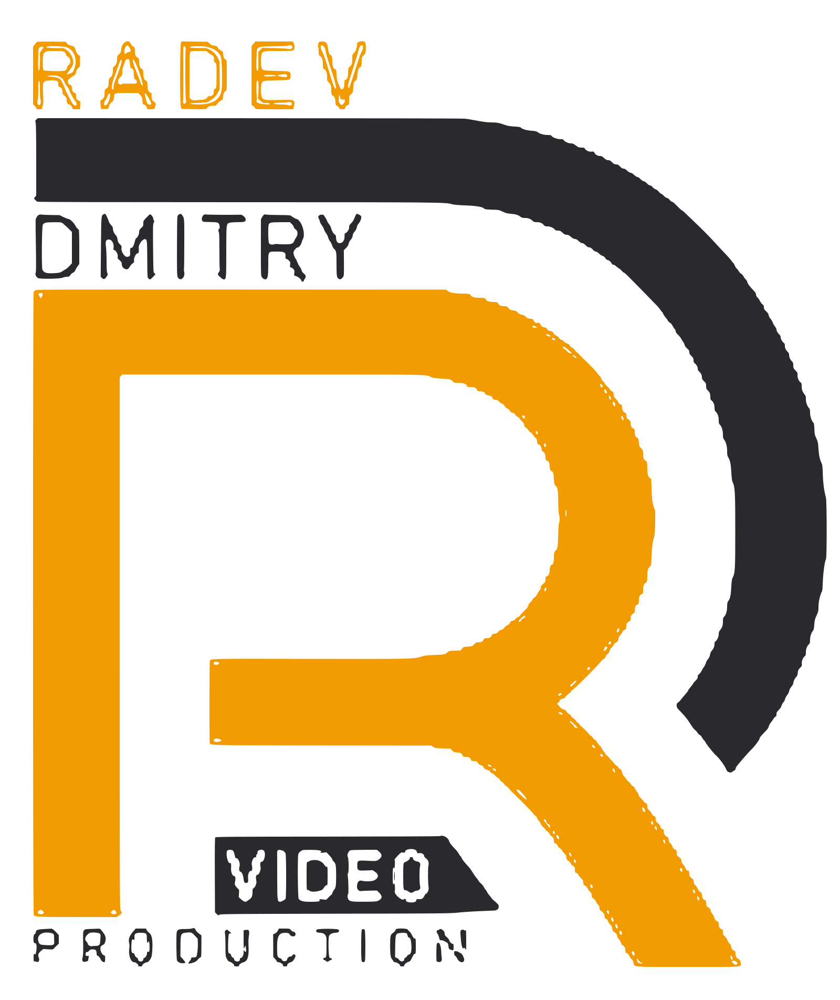
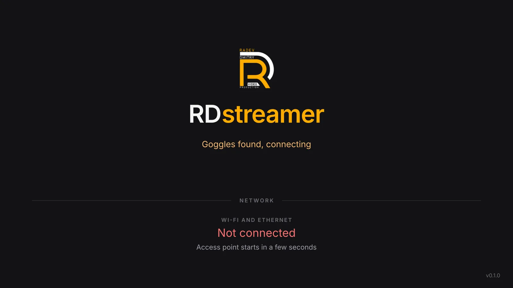
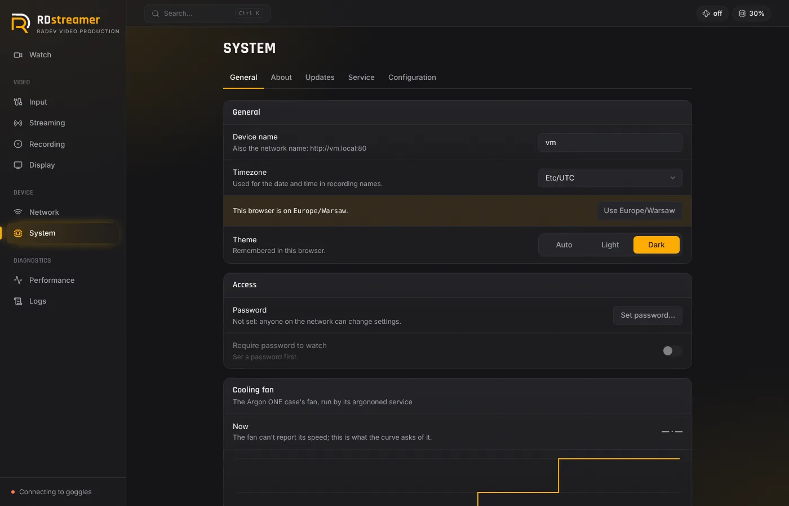
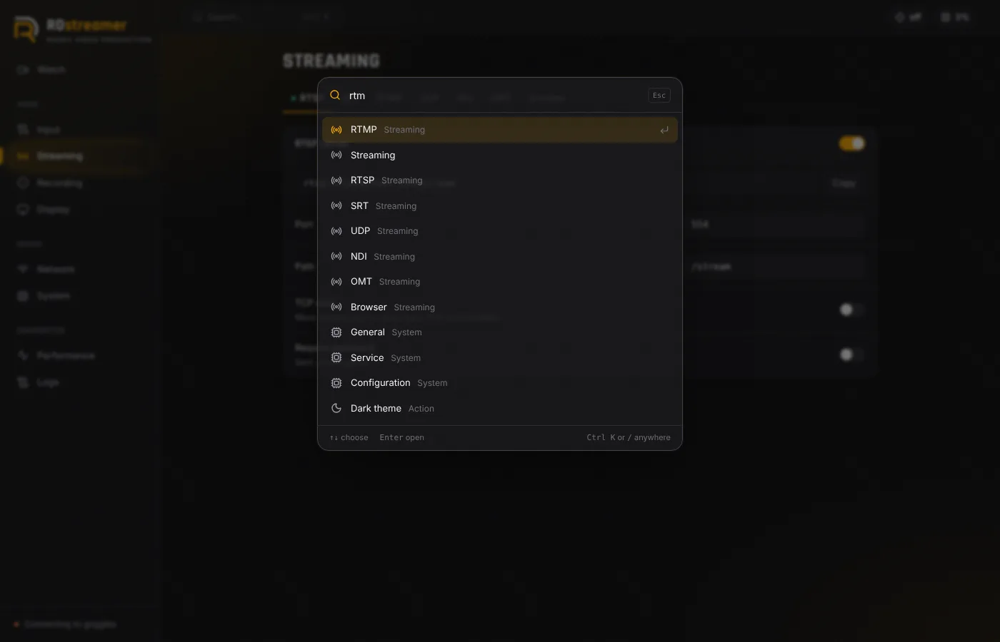

<div align="center">

<picture>
  <source media="(prefers-color-scheme: dark)" srcset="docs/rdstreamer/logo-dark.svg" />
  
</picture>

# RDstreamer

**Your FPV feed, on every screen — graded, straightened and steadied.**

Raspberry Pi 4 software that takes the live video from your DJI goggles or a USB
camera and sends it to an HDMI screen, any browser, RTSP/SRT/RTMP/UDP streams,
NDI/OMT and recordings, all at once. Made for the Argon ONE case, with working
fan control.

[](LICENSE)
[](https://www.raspberrypi.com/products/raspberry-pi-4-model-b/)
[](https://www.rust-lang.org)

[**⬇️ Download**](https://github.com/radievdmytro/RDstreamer/releases) &nbsp;·&nbsp;
[**🆕 Changelog**](CHANGELOG.md) &nbsp;·&nbsp;
[**🚀 Getting started**](#getting-started)



</div>

> [!IMPORTANT]
> **Made for the Raspberry Pi 4 in an Argon ONE (V2) case.** The case's fan,
> power button and power cut work out of the box, set from the web interface.
> No Argon40 scripts or `argononed` needed.

---

## Features

### 🎞️ The picture: LUTs, lens correction, stabilisation

Graded on the Pi's GPU for HDMI, in one pass, live as you move the sliders.

- **3D LUTs** — built-in looks (film, warm, cool, teal & orange, punchy, vivid
  FPV, black & white, HLG → Rec.709), your own `.cube` library (DJI D-Log /
  D-Log M / D-Cinelike, Resolve exports…) and a free LUT pack to download, with
  a strength slider.
- **Dewarp** — fisheye and edge correction, zoom and offsets.
- **Stabilisation** — measured from the picture itself: separate **Shake**,
  **Horizon** and **Zoom** controls, deliberate pans let through, no stretching.
  **Look ahead** (0.25 – 1 s) trades a little delay for a steadier picture.
- **Live preview** on Display → Image: Before / Split / After, drawn by your
  browser with the same shader as the Pi.
- **Speed** (720p, 60 fps) or **Quality** (full size) processing.

### 🎚️ Processing where you want it

- **Per output**: a **Processing** switch on each of RTSP, SRT, RTMP and UDP.
  Off by default, so OBS gets the flat picture to grade; on, it gets the HDMI
  look, encoded again by the Pi (1080p30), with a status line saying whether it
  runs and why not. Recordings always keep the original.
- **Browsers grade it themselves**: the Pi sends the original, and each browser
  applies the LUT and Dewarp with its own graphics — no load on the Pi. On by
  default; every viewer can switch it off in their menu.

### 👀 Viewers and guests

- **A clean page for guests** at the plain address: the logo, the picture and
  its status. Settings live behind **`/admin`** (or three taps on the logo).
- Guests choose **Quality** (Auto / Original / Light), **Connection**
  (WebRTC / WebSocket) and **Processing** for themselves.
- **Light stream** for weak Wi-Fi: 720p30 at 3.5 Mbit/s, picked automatically
  when a viewer falls behind.
- **Opens by itself when a phone joins** the RDstreamer Wi-Fi (like a hotel
  sign-in page), with the address in large type and a **Copy address** button
  for opening it in the real browser.

### 🖥️ HDMI and the splash screen

- Recovers by itself from a frozen decoder or a pipeline that won't start.
- No doubled frames with the GPU look on.
- **Background video** behind the splash screen, turned on and off in one click.
- The connection details over it: **a band along the bottom**, **a compact box
  in any corner**, or **hidden**.

### 📶 Network

- **A second USB Wi-Fi adapter** for the internet while the built-in Wi-Fi keeps
  the access point.
- **Channel scanner**: the load on each 2.4 GHz channel and the clearest of
  1, 6 and 11.
- **Status bar** with power warnings, Wi-Fi clients and their signal.

### 🔄 Updates

- **Signed RDstreamer releases**, found, downloaded and verified by the device
  itself, with progress you can see. Optionally installed when the device is
  idle.

### ⏱️ Sync Clock

- **`/sync`**: time to the millisecond, frame and timecode at 24 – 60 fps, a
  frame bar and flashes for syncing cameras. Every screen shows the device's
  time; set your own or nudge it by ±1 h / min / s.

### 🌀 Argon ONE case, built in

- **Fan curve set in the browser** (System → General → Cooling fan); it must
  reach 100 % by 75 °C, so the Pi can't be left to overheat.
- **Power button**: double tap reboots, a 3 s hold powers off (recordings are
  finished first). **Power cut** after shutdown.
- Optional **spin-up kick**; **one-click move from `argononed`** with its curve.



### 🎨 The interface

- Dark grey with the orange of the RD logo (light theme too), a status bar on
  every page, a command palette (<kbd>Ctrl</kbd>/<kbd>⌘</kbd>+<kbd>K</kbd> or
  <kbd>/</kbd>) and a bottom bar with a big record button on phones.

<table>
  <tr>
    <td width="50%"><br /><sub><b>Watch page, dark</b></sub></td>
    <td width="50%"><br /><sub><b>Light theme</b></sub></td>
  </tr>
  <tr>
    <td width="62%"><br /><sub><b>Command palette</b></sub></td>
    <td width="38%"><br /><sub><b>On a phone</b></sub></td>
  </tr>
</table>

### And everything you'd expect

- **HDMI** to a TV, monitor or projector, with your logo.
- **Streams**: an RTSP server, plus SRT, RTMP (YouTube, Twitch, Facebook) and
  UDP for OBS, VLC, QGroundControl and Mission Planner.
- **NDI and OMT** sources that vMix, OBS and TriCaster find by themselves.
- **Recording** to MP4 or MPEG-TS on the SD card or a USB drive: by hand,
  when video arrives, or with a button.
- **The air unit's camera settings**, the goggles' battery and link quality,
  DJI Fly pass-through on Android, and remote access over Tailscale or
  WireGuard.

---

## Getting started

1. [Download `….img.xz`](https://github.com/radievdmytro/RDstreamer/releases)
   from the latest release.
2. Flash it with Raspberry Pi Imager (**Use custom**) or balenaEtcher.
3. Boot the Pi, join the **`RDstreamer`** Wi-Fi (password `RDstreamer`). The
   viewer opens by itself; settings are at `http://10.0.0.1/admin` or
   `http://rdstreamer.local/admin`. An HDMI screen shows the details and a QR
   code too.
4. Set a password under **System → General → Access**, and change the SSH
   password (`rdstreamer` / `rdstreamer`).

Later versions install from **System → Updates**.

### Supported inputs

| Source                                        | Port  | Video | Camera settings | Battery & link |
| --------------------------------------------- | :---: | :---: | :-------------: | :------------: |
| DJI Goggles 2, Integra, Goggles 3, Goggles N3 | USB-C |  ✅   |       ✅        |       ✅       |
| DJI RC-N2 / RC-N3 remote _(experimental)_     | USB-C |  ✅   |       ❔        |       ❔       |
| DJI FPV Goggles V1 / V2 _(experimental)_      | USB-A |  ✅   |       ❌        |       ❌       |
| USB cameras, capture sticks, analog receivers | USB-A |  ✅   |        -        |       -        |
| RTMP stream from OBS, a phone app or DJI Fly  |  LAN  |  ✅   |        -        |       -        |

_Which camera settings can be changed depends on the air unit (O3, O4, O4 Pro)._

### What you need

- **Raspberry Pi 4 Model B**, ideally in an **Argon ONE (V2)** case.
- **A microSD card**, 16 GB or more.
- **Power that leaves the Pi's USB-C port free**: the Argon ONE case's own
  USB-C input, the GPIO header or a PoE HAT. The Pi's USB-C port is for the
  goggles. A 5.25 V / 3.5 A supply is recommended, more so with a USB Wi-Fi
  adapter.
- **A USB-C to USB-C data cable** for the goggles, or a USB camera.

The access point runs on 2.4 GHz only, on purpose: 5 GHz is where the goggles'
video link lives.

> [!NOTE]
> RDstreamer is an independent project, not affiliated with, endorsed by or
> sponsored by DJI or Argon40.

---

## Building from source

Tasks run through [mise](https://mise.jdx.dev), which also installs the
toolchains (Rust, Node, pnpm):

```sh
# The web interface against a device on your network, with hot reload
cd device/frontend && pnpm install && PI_HOST=192.168.x.x pnpm dev

# Checks
mise run lint
mise run backend:test

# What ships: the .deb, then the SD card image (needs Docker)
mise run device:deb
image/build.sh
```

Or let GitHub do it: **Actions → Build RDstreamer → Run workflow**, with a name
starting with the version (`1.23 · …`). See [CONTRIBUTING.md](CONTRIBUTING.md).

| Path                | What's inside                                                             |
| ------------------- | ------------------------------------------------------------------------- |
| `device/backend/`   | The service (Rust, GStreamer): video, outputs, web server, the Argon case |
| `device/frontend/`  | The web interface (Svelte), compiled into the backend                     |
| `device/packaging/` | The Debian package and install script                                     |
| `image/`            | The ready-made SD card image (pi-gen)                                     |

Some internal names (the `ystreamer` command and service, `/etc/ystreamer`)
are kept from the original project, so existing devices keep updating.

## Based on YStreamer

RDstreamer is a modified version of [YStreamer](https://github.com/YLabs-FPV/YStreamer)
by YarosFPV, whose [documentation](https://ystreamer.yarosfpv.com/docs) still
covers the basics. Thanks also to
[Argon40](https://github.com/Argon40Tech/Argon40case),
[GStreamer](https://gstreamer.freedesktop.org), [FFmpeg](https://ffmpeg.org),
[webrtc-rs](https://github.com/webrtc-rs/webrtc), [Tokio](https://tokio.rs),
[Axum](https://github.com/tokio-rs/axum), [Svelte](https://svelte.dev),
[Tailwind CSS](https://tailwindcss.com), [Lucide](https://lucide.dev),
[xterm.js](https://xtermjs.org), [pi-gen](https://github.com/RPi-Distro/pi-gen),
[CosmoStreamer](https://cosmostreamer.com),
[SquirrelCast](https://xnuclearsquirrel.github.io/SquirrelCast-Public),
[samuelsadok/dji_protocol](https://github.com/samuelsadok/dji_protocol) and
[wllm-rbnt/third-eye](https://github.com/wllm-rbnt/third-eye).

## License

Free software under the **GNU General Public License v3.0**. See
[`LICENSE`](LICENSE).

Copyright © 2026 YarosFPV (original work) · © 2026 Dmitry Radev (RDstreamer)
